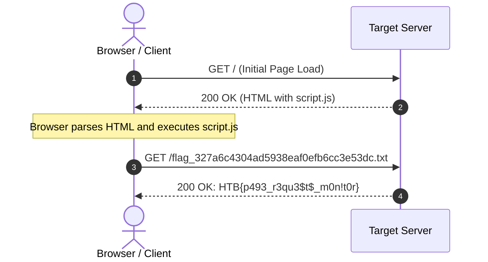
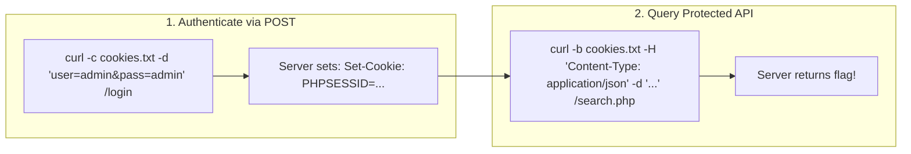

# 🎬 Web Requests Mastery: From Basics to API Manipulation
### A Complete Video Masterclass & Reference Guide (HTB Academy)

> **Achievement Unlocked:** [Web Requests Module Badge](https://academy.hackthebox.com/achievement/549378/35)  
> **Student:** `4navaneeth4_1` | **Status:** 100% Completed | **Rank:** Beginner 2

---

## 📺 Video Overview & Production Blueprint

* **Target Audience:** Aspiring penetration testers, bug bounty hunters, and developers.
* **Format:** Interactive screen recording + animated slides + terminal overlays.
* **Total Runtime:** ~15–18 minutes across 5 chapters.

---

## Chapter 1: The Invisible Language of the Web (00:00 – 03:00)

### 🎥 Visual Storyboard
- **Visuals:** Split screen showing a user typing a URL in Chrome on the left, and Wireshark/DevTools capturing plaintext HTTP packets on the right.
- **Graphic:** A stylized diagram showing a Client (Browser/cURL) sending a Request Envelope and receiving a Response Envelope.

### 🎙️ Narrator Script
> *"Every single click, search, and video you stream online is powered by HTTP requests. But as security researchers, we never trust the browser UI. We look under the hood at the raw HTTP protocol: the method, the path, the headers, and the body.*
>
> *HTTP is stateless and request-response driven. Every interaction starts with a client request and ends with a server response containing a status code.*
>
> *Remember the status code cheat sheet:*
> * `1xx`: Informational — Hold on, processing.
> * `2xx`: Success — `200 OK`, request handled cleanly.
> * `3xx`: Redirection — `301 Moved Permanently`, `302 Found` (e.g. redirect to dashboard after login).
> * `4xx`: Client Error — `400 Bad Request`, `401 Unauthorized` (missing credentials), `403 Forbidden` (no permission), `404 Not Found`.
> * `5xx`: Server Error — `500 Internal Server Error`, `502 Bad Gateway`. If you see a 500 in pentesting, you likely triggered an unhandled exception or SQL/Command injection bug!"*

---

## Chapter 2: HTTP Headers & Unmasking Hidden DevTools Traffic (03:00 – 06:30)

### 🎥 Visual Storyboard
- **Visuals:** Browser DevTools (`F12`) opened to the **Network** tab.
- **Action:** Reloading the target page. Showing the asynchronous `fetch()` call firing in `script.js` in the background.



### 🎙️ Narrator Script
> *"Headers are metadata that describe either the message or the payload. We group them into:*
> 1. **Request Headers:** *`Host`, `User-Agent`, `Referer`, `Cookie`, `Authorization`.*
> 2. **Response Headers:** *`Server`, `Set-Cookie`, `Location`.*
> 3. **Security Headers:** *`Content-Security-Policy` (stops XSS), `Strict-Transport-Security` (forces HTTPS), `X-Frame-Options: DENY` (stops clickjacking), and `X-Content-Type-Options: nosniff`.*
>
> *In our first lab challenge, the web page loaded recommended modules, but the flag wasn't anywhere on the screen!*
>
> *By opening DevTools or reading `script.js`, we saw this critical line:*
> `document.onload(fetch('/flag_327a6c4304ad5938eaf0efb6cc3e53dc.txt'));`
>
> *The browser fetched the flag asynchronously after the initial render! Curling that endpoint directly gave us our first 20 Cubes:"*

```bash
curl -s http://154.57.164.68:39329/flag_327a6c4304ad5938eaf0efb6cc3e53dc.txt
# Output: HTB{p493_r3qu3$t$_m0n!t0r}
```

---

## Chapter 3: Mastering cURL & Basic Authentication (06:30 – 10:00)

### 🎥 Visual Storyboard
- **Visuals:** Fullscreen terminal demonstrating cURL command variations side-by-side with DevTools "Copy as cURL".

### 🎙️ Narrator Script
> *"As a hacker, cURL is your Swiss Army knife. You must master these flags:*
> * `-v` *(Verbose): Shows the complete handshake, outgoing request headers (`>`), and incoming response headers (`<`).*
> * `-i` *(Include headers): Shows HTTP response headers + the body.*
> * `-I` *(Head): Sends a `HEAD` request to inspect response headers without downloading the body.*
> * `-s` *(Silent): Hides the progress meter, essential for piping output into tools like `jq`.*
>
> *Next, we tackled **HTTP Basic Authentication**. Unlike form-based logins, Basic Auth is handled directly by the web server (Apache/Nginx) before the web app is even reached.*
> *If you visit without credentials, the server returns:*
> `HTTP/1.1 401 Authorization Required`
> `WWW-Authenticate: Basic realm="Access denied"`
>
> *Under the hood, the client sends:*
> `Authorization: Basic YWRtaW46YWRtaW4=`
> *(which is simply `admin:admin` encoded in base64!).*
>
> *In our lab, the web search UI was broken and returning wrong data. But by inspecting `script.js`, we found the backend endpoint: `/search.php?search=`. We bypassed the broken UI and called the API directly with cURL:"*

```bash
curl -s -u admin:admin "http://154.57.164.70:30626/search.php?search=flag"
# Output: flag: HTB{curl_g3773r}
```

---

## Chapter 4: POST Requests, Payloads & Cookie Jars (10:00 – 13:30)

### 🎥 Visual Storyboard
- **Visuals:** Animation contrasting GET query parameters in the URL bar with POST request bodies.
- **Terminal View:** Demonstrating `-c` (cookie writing) and `-b` (cookie reading).



### 🎙️ Narrator Script
> *"Why use POST instead of GET? Three reasons:*
> 1. **No URL Logging:** *Passphrases and sensitive data in GET URLs get stored in browser history, proxy logs, and server access logs.*
> 2. **Arbitrary Data Sizes:** *URLs are capped around 2,000 characters. POST bodies can send gigabytes of files, images, or JSON.*
> 3. **Binary Data:** *POST accepts raw multipart streams without URL-encoding constraints.*
>
> *In Lab 3, we had a two-step challenge:*
> *First, we logged in with user `admin:admin` and stored our session cookie in a local file with `-c`:*

```bash
curl -s -i -c /tmp/cookies.txt -X POST \
  -d "username=admin&password=admin" \
  http://154.57.164.64:41628/
```

> *The server issued: `Set-Cookie: PHPSESSID=...`*
> *Then, using `-b /tmp/cookies.txt`, we supplied that session cookie and sent a JSON payload to `/search.php`:*

```bash
curl -s -b /tmp/cookies.txt -X POST \
  -H "Content-Type: application/json" \
  -d '{"search":"flag"}' \
  http://154.57.164.64:41628/search.php
# Output: ["flag: HTB{p0$t_r3p34t3r}"]
```

---

## Chapter 5: Cracking CRUD REST APIs (13:30 – 17:00)

### 🎥 Visual Storyboard
- **Visuals:** Architectural diagram of a REST API connected to a SQL database.
- **Terminal:** Running `PUT`, `DELETE`, and `GET` in succession.

| CRUD Operation | HTTP Method | Target API URL | Purpose |
| :--- | :--- | :--- | :--- |
| **Create** | `POST` | `/api.php/city/` | Adds a new record to the database table |
| **Read** | `GET` | `/api.php/city/{name}` | Retrieves a record or lists all records |
| **Update** | `PUT` / `PATCH` | `/api.php/city/{name}` | Overwrites (`PUT`) or modifies (`PATCH`) a record |
| **Delete** | `DELETE` | `/api.php/city/{name}` | Removes a record from the database table |

### 🎙️ Narrator Script
> *"Modern web apps don't reload pages; they talk to RESTful CRUD APIs. Many APIs expose endpoints like `/api.php/table/identifier`.*
>
> *In our final challenge, the task required a multi-step state change:*
> 1. *Update an existing city's name to `'flag'` using `PUT`.*
> 2. *Delete any city using `DELETE`.*
> 3. *Query the API for `'flag'` using `GET`.*
>
> *Watch how clean this is when executed directly through cURL:"*

```bash
# 1. Update London to 'flag'
curl -s -X PUT http://154.57.164.71:32077/api.php/city/London \
  -H "Content-Type: application/json" \
  -d '{"city_name":"flag", "country_name":"(UK)"}'

# 2. Delete Leeds
curl -s -X DELETE http://154.57.164.71:32077/api.php/city/Leeds

# 3. Read the 'flag' record
curl -s http://154.57.164.71:32077/api.php/city/flag
# Output: [{"city_name":"flag","country_name":"HTB{crud_4p!_m4n!pul4t0r}"}]
```

> *"And with that final payload, the server surrendered the flag, marking the entire module 100% complete!"*

---

## 🛠️ The Pentester's cURL Command Cheat Sheet

| Task | Command |
| :--- | :--- |
| **Inspect Response Headers Only** | `curl -s -I http://target/` |
| **Inspect Request & Response Headers** | `curl -v http://target/` |
| **HTTP Basic Authentication** | `curl -u username:password http://target/` |
| **Custom Header Injection** | `curl -H "X-Forwarded-For: 127.0.0.1" http://target/` |
| **Change User-Agent** | `curl -A "Mozilla/5.0" http://target/` |
| **POST Form Data** | `curl -X POST -d "user=admin&pass=admin" http://target/login` |
| **POST JSON Payload** | `curl -X POST -H "Content-Type: application/json" -d '{"id":1}' http://target/api` |
| **Save Cookies to File** | `curl -c cookies.txt -d "..." http://target/login` |
| **Send Saved Cookies** | `curl -b cookies.txt http://target/dashboard` |
| **REST API Update** | `curl -X PUT -H "Content-Type: application/json" -d '{"status":"active"}' http://target/api/user/1` |
| **REST API Delete** | `curl -X DELETE http://target/api/user/1` |
