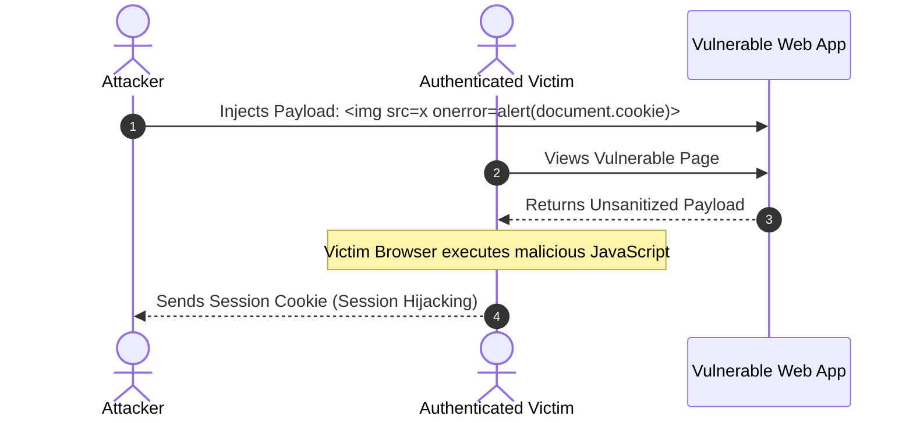
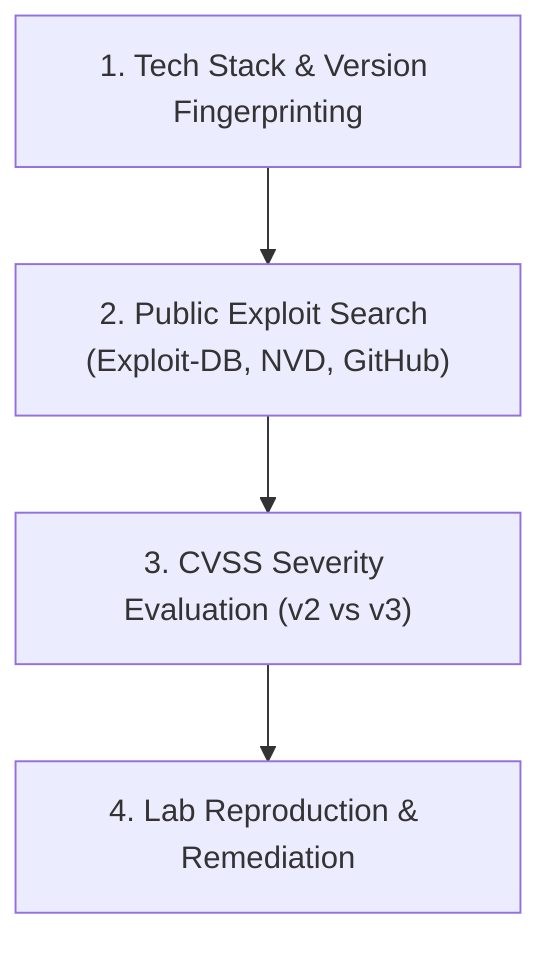

# 🎬 Introduction to Web Applications: Anatomy, Architecture & Exploitation
### A Complete Video Masterclass & Production Blueprint (HTB Academy)

---

## 📺 Video Overview & Production Blueprint

* **Target Audience:** Security beginners, bug bounty hunters, web developers, and SOC analysts.
* **Format:** Interactive terminal overlays + architecture animations + live lab exploit demonstrations.
* **Total Runtime:** ~20–25 minutes across 6 structured chapters.
* **Tone:** Professional, engaging, pedagogical, and security-first.

---

## Chapter 1: The Blueprint — Web Architecture & The Client-Server Model (00:00 – 04:00)

### 🎥 Visual Storyboard
- **Visuals:** 3D animated multi-layer stack exploding into its core tiers: Presentation (Client Browser) ➔ Logic (Web Server & Runtime) ➔ Data Access (Database & Cloud Storage).
- **On-Screen Graphic:** Tiered architecture flow diagram.

```mermaid
graph TD
    Client["Client / Browser (HTML, CSS, JS)"] -->|HTTP / HTTPS Request| WebServer["Web Server (Nginx / Apache / IIS)"]
    WebServer -->|Passes to Runtime| AppLogic["Application Logic (PHP, Node.js, Python, Java)"]
    AppLogic -->|SQL / NoSQL Query| Database[("Database (MySQL, PostgreSQL, MongoDB)")]
    Database -->>|Record Set| AppLogic
    AppLogic -->>|Generates Output / JSON| WebServer
    WebServer -->>|HTTP Response (HTML / Assets / JSON)| Client
```

### 🎙️ Narrator Script
> *"Welcome to Introduction to Web Applications! Every modern cyber attack against an organization usually begins at the web application layer. Why? Because web apps are publicly exposed to the entire internet on ports 80 and 443.*
>
> *To break a web application—and more importantly, to defend it—you must first understand how all the moving pieces communicate.*
>
> *At its core, a web application is divided into two distinct worlds:*
> 1. **The Front End (Client-Side):** *What runs inside the user's browser. It consists of HTML for structure, CSS for styling, and JavaScript for behavior and interactivity.*
> 2. **The Back End (Server-Side):** *What runs on the remote server infrastructure. It consists of the host OS, web server (like Apache or Nginx), the backend development runtime (PHP, Node.js, Python), and the database (MySQL, MongoDB, PostgreSQL).*
>
> *In 1-tier architectures, everything lives on one machine. In modern N-tier enterprise architectures, requests flow through reverse proxies, load balancers, containerized microservices, and decoupled database clusters.*
>
> *Let's drill into the front-end components and see how innocent developer oversights turn into critical vulnerabilities."*

---

## Chapter 2: The Front End Trio & Sensitive Data Exposure (04:00 – 08:00)

### 🎥 Visual Storyboard
- **Visuals:** Split screen showing a stylish login portal on the left, and Chrome DevTools (`Ctrl + U` / Elements tab) on the right.
- **Action:** Highlighting green developer comments lurking inside the HTML DOM.
- **Terminal Overlay:** Running `curl -s http://<target-ip>:<port> | grep -i "TODO"` to instantly reveal hardcoded credentials without a browser.

### 🎙️ Narrator Script
> *"Every browser interprets three core technologies:*
> * `HTML`: The skeleton (e.g. ``, `<form>`, `<input>`, `<a>`).
> * `CSS`: The skin (styling, layouts, responsive rules).
> * `JavaScript`: The nervous system (DOM manipulation, async event listeners, dynamic UI updates).
>
> *Here is the golden rule of front-end security: **Everything delivered to the client's browser is completely readable and controllable by the client!**
>
> *Developers frequently forget that HTML and JavaScript comments are NOT stripped automatically in production environments unless build minification pipelines are strictly enforced.*
>
> *Let's look at our first hands-on lab. We inspected an ordinary-looking login form. By pulling the raw HTML source code:*
>
> ```html
> <div class="container">
>     <label for="uname"><b>Username</b></label>
>     <input type="text" required>
>     <label for="psw"><b>Password</b></label>
>     <input type="password" required>
>     <!-- TODO: remove test credentials admin:HiddenInPlainSight -->
>     <button type="submit">Login</button>
> </div>
> ```
>
> *Right there in plain text: `admin:HiddenInPlainSight`!*
>
> *As a security assessor or bug bounty hunter, always check the page source (`Ctrl + U`), search for `TODO`, `FIXME`, API endpoints, commented-out testing flags, and sensitive staging keys."*

---

## Chapter 3: Front-End Injections: HTMLi, XSS & CSRF (08:00 – 13:00)

### 🎥 Visual Storyboard
- **Visuals:** Diagram distinguishing between Reflected, Stored, and DOM-based Cross-Site Scripting.
- **Live Demo:** Demonstrating DOM XSS cookie extraction inside an interactive prompt.
- **Diagram:** Sequence diagram comparing an XSS session hijack vs a CSRF forged state change.



### 🎙️ Narrator Script
> *"When a web application accepts input from a user and reflects it onto the page without proper encoding or sanitization, injection occurs:*
>
> 1. **HTML Injection:**
> *If an application blindly echoes user input into the DOM:*
> ```javascript
> document.getElementById("output").innerHTML = "Your name is " + input;
> ```
> *If an attacker supplies `<a href="http://evil.com">Click Me</a>`, the browser renders a hyperlinked anchor rather than plain text. Attackers use this to deface websites, inject phishing forms, or hijack user navigation.*
>
> 2. **Cross-Site Scripting (XSS):**
> *HTML injection escalates to XSS when executable JavaScript is injected. There are three primary types:*
> * **Reflected XSS:** *Payload comes from the immediate HTTP request (URL parameter, search query) and is reflected back.*
> * **Stored XSS:** *Payload is saved to the database (comments, profiles) and executes whenever anyone views that record.*
> * **DOM XSS:** *The payload never touches the backend server—it is processed entirely in the browser's DOM.*
>
> *In our lab, we bypassed an input prompt using an event-handler image payload:*
> ```html
> #">
> ```
> *The browser failed to load image `/`, fired the `onerror` event, and displayed the active session cookie: `cookie=XSSisFun`! In real attacks, this cookie is exfiltrated to an attacker's webhook, allowing instant session takeover.*
>
> 3. **Cross-Site Request Forgery (CSRF):**
> *While XSS steals data and executes code in the context of the user, CSRF forces the victim's browser to execute an unwanted state-changing action (like updating an email or changing a password) using their existing authenticated session.*
>
> *Defenses:*
> * **Sanitization & Output Encoding:** *HTML-encode `<`, `>`, `"`, `'`, and `&`.*
> * **Anti-CSRF Tokens:** *Unpredictable, unique tokens validated on every POST/PUT/DELETE request.*
> * **Cookie Flags:** *`SameSite=Strict` or `SameSite=Lax`, combined with `HttpOnly` to block JavaScript access.*"*

---

## Chapter 4: The Back End Powerhouse — Web Servers, Stacks & Databases (13:00 – 17:00)

### 🎥 Visual Storyboard
- **Visuals:** Grid breakdown of common solution stacks (LAMP, WAMP, MAMP, WINS, MEAN).
- **Comparison Table:** Relational (SQL) vs Non-Relational (NoSQL) database paradigms.

| Stack Type | Operating System | Web Server | Database | Development Runtime |
| :--- | :--- | :--- | :--- | :--- |
| **LAMP** | Linux | Apache | MySQL | PHP |
| **WAMP** | Windows | Apache | MySQL | PHP |
| **WINS** | Windows | IIS | SQL Server | .NET / C# |
| **MAMP** | macOS | Apache | MySQL | PHP |
| **MEAN** | Linux / Cross | Node.js | MongoDB | Express / Angular |

### 🎙️ Narrator Script
> *"Now let's cross the boundary into the back end. The back-end server hosts the operating system and the software stack that powers the entire application.*
>
> *Web servers—such as Apache, Nginx, Microsoft IIS, and Node.js—listen for raw TCP traffic, parse HTTP headers, manage SSL/TLS certificates, and route requests to application handlers.*
>
> *Remember HTTP response codes when communicating with web servers:*
> * `200 OK`: Request succeeded.
> * `201 Created`: A new resource was successfully generated via PUT/POST.
> * `401 / 403`: Unauthorized vs Forbidden.
> * `404 Not Found`: Missing resource.
> * `500 Internal Server Error`: Unhandled crash on the server.
>
> *Underneath the web server sits the database:*
> 1. **Relational (SQL):** *Data is stored in strict structured tables with rows, columns, and foreign keys. Examples: MySQL, PostgreSQL, MSSQL, Oracle, SQLite.*
> 2. **Non-Relational (NoSQL):** *Data is stored as key-value pairs, JSON documents, wide-columns, or graphs. Highly scalable, dynamic schemas. Examples: MongoDB, Redis, ElasticSearch, and Google Firebase Database.*
>
> *Understanding whether a target uses SQL or NoSQL dictates your entire exploitation strategy: standard SQLi union techniques versus NoSQL BSON operator injections (`{"$gt": ""}`)."*

---

## Chapter 5: REST APIs & Backend Exploitation (17:00 – 21:00)

### 🎥 Visual Storyboard
- **Visuals:** Postman/cURL terminal sending GET/POST/PUT/DELETE requests to an API endpoint.
- **Terminal Demo:** Interrogating an ID-based API parameter: `curl -s "http://<target>/index.php?id=1"`.

```mermaid
graph LR
    Client["Client / Pentester"] -->|GET /index.php?id=1| API["Backend REST Endpoint"]
    API -->|Query ID=1| DB[("User Table")]
    DB -->>|Record: superadmin| API
    API -->>|Plaintext Response: 'superadmin'| Client
```

### 🎙️ Narrator Script
> *"Modern web apps rarely render static pages; they communicate with RESTful APIs using standard HTTP verbs:*
> * `GET`: Retrieve resources (idempotent).
> * `POST`: Create new resources.
> * `PUT`: Replace or update an entire resource.
> * `DELETE`: Remove a resource.
>
> *In our backend lab, the application exposed an endpoint accepting an ID parameter. By querying `/index.php?id=1`, the database looked up the user record and returned the username: `superadmin`!*
>
> *When backend parameters are not properly validated, they open the door to severe vulnerabilities:*
> * **Broken Access Control (IDOR):** *Changing `id=1` to `id=2` to view other users' private data.*
> * **SQL Injection (SQLi):** *Injecting `' OR 1=1 --` into parameters to dump the entire database.*
> * **Command Injection:** *Supplying shell metacharacters like `|`, `;`, or `&&` into input fields that get passed to OS commands (e.g. `ping`, `nslookup`, or `imagemagick`).
> * **Arbitrary File Upload:** *Uploading a PHP web shell disguised as an image (e.g. `shell.php.jpg` or null byte bypasses) to achieve Remote Code Execution (RCE)."*

---

## Chapter 6: Public CVEs, CVSS Scoring & The Hacker's Roadmap (21:00 – 24:00)

### 🎥 Visual Storyboard
- **Visuals:** NIST NVD CVSS v3.1 calculator UI showing Base, Temporal, and Environmental metrics.
- **Graphic:** Breakdown of famous CVE-2017-0144 (EternalBlue) and CVE-2014-6271 (Shellshock).



### 🎙️ Narrator Script
> *"Before you attempt to find zero-day vulnerabilities, always check for known public CVEs!*
>
> *When you fingerprint a web application, identify the exact version number from `version.php`, headers, or footer tags. Then query exploit databases like Exploit-DB, Packet Storm, and the NIST National Vulnerability Database (NVD).*
>
> *Every vulnerability is cataloged with a Common Vulnerabilities and Exposures (CVE) ID and scored using CVSS (Common Vulnerability Scoring System):*
> * **Low:** 0.1 – 3.9
> * **Medium:** 4.0 – 6.9
> * **High:** 7.0 – 8.9
> * **Critical:** 9.0 – 10.0
>
> *For example, the legendary Windows SMB vulnerability **CVE-2017-0144** (EternalBlue) carries a massive CVSS v2 base score of **9.3**! Similarly, **CVE-2014-6271** (Shellshock) shook the web because it allowed remote command injection against web servers running CGI Bash scripts.*
>
> *To become a master penetration tester:*
> 1. *Set up your own lab with Apache, PHP, and MySQL.*
> 2. *Build a simple CRUD application from scratch so you know how developers write code.*
> 3. *Break your own application with SQLi, XSS, and command injection.*
> 4. *Patch the vulnerabilities with parameterized queries and strict input encoding.*
>
> *You've officially completed Introduction to Web Applications on HTB Academy! Keep practicing, keep hacking ethically, and see you in the next module!"*
